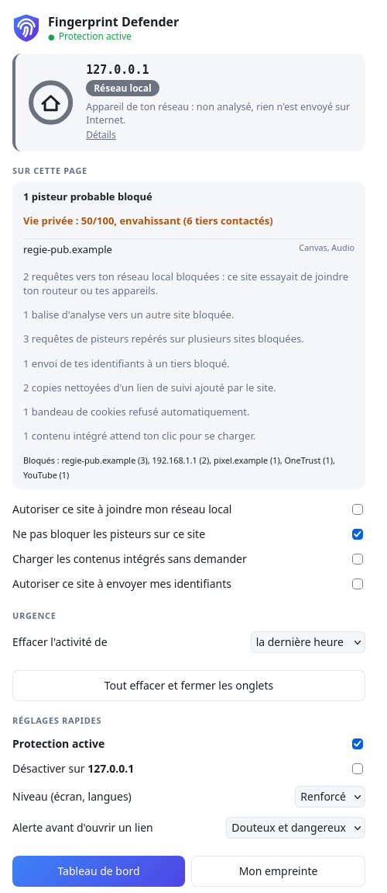
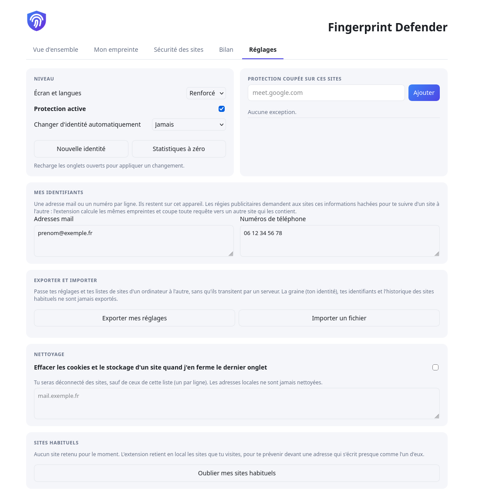

# Fingerprint Defender

Extension Firefox 128+ (Manifest V3) en trois volets : brouiller les empreintes de navigateur sans casser les sites qui détectent les bloqueurs, couper les fuites et nuisances, et évaluer la fiabilité des sites avant de les ouvrir.

## Aperçu

Captures dans un vrai Firefox, avec des données d'exemple (sites et identifiants fictifs).

<p>
  
</p>

<p>
  
</p>

## Structure du projet

```
manifest.json
icons/                     icône de l'extension
src/
  background/              script d'arrière-plan, découpé par rôle
    background.js          réglages initiaux, filtre des adresses, statistiques, garde de navigation
    reputation.js          score de fiabilité des sites, listes de menaces
    settings.js            réglages gardés en mémoire pour les écouteurs réseau
    headers.js             Accept-Language, Sec-GPC, Referer
    network.js             pings et balises, accès au réseau local
    trackers.js            pisteurs appris d'après leur comportement
    identifiers.js         tes identifiants envoyés à des tiers
    embeds.js              contenus intégrés chargés au clic
    redirects.js           pages AMP vers la vraie page
    payment.js             à qui part ta carte, et sa réputation
    habits.js              sites habituels retenus (faute de frappe)
    downloads.js           exécutables et doubles extensions
    tls.js                 connexion chiffrée et certificat
    cleanup.js             nettoyage à la fermeture d'un site, bouton d'urgence
    containers.js          menu du clic droit : conteneur jetable, lien propre
    activity.js            tiers contactés, bilan de la semaine
    identity.js            changement automatique d'identité, identité par conteneur et fenêtre privée
    workers.js             noyau de brouillage copié en tête des scripts de worker
  content/                 scripts injectés dans les pages
    content.js             monde isolé : réglages, liens, bandeaux, analyse de la page
    inject.js              monde de la page : canal protégé, cadres et workers, presse-papiers
    scams.js               saisie de carte, fausse fenêtre de connexion, onglet qui change
    banner.js              l'avertissement dessiné dans la page
  shared/                  partagé par tous : réglages par défaut et fonctions pures, règles de consentement, détection du presse-papiers, libellés, style
    noise-core.js          le noyau du brouillage, appliqué à la page, aux cadres et aux workers
  pages/
    popup/                 le popup de la barre d'outils
    dashboard/             le tableau de bord, la mesure de l'empreinte et l'auto-test
    blocked/               la page d'avertissement avant un site de phishing
    embed/                 le cadre qui remplace une vidéo ou une carte intégrée
scripts/
  capture.js               captures d'écran de l'interface dans Firefox
tests/
  unit/                    tests sans navigateur
  firefox/                 tests dans un vrai Firefox (serveur local et pages de test dans fixtures/)
```

Les fonctions pures (clé de site, score, réseau local, Referer...) sont dans `src/shared/defaults.js`, pour être testées sans navigateur.

## Installation

Sur PC :

1. Ouvrir `about:debugging#/runtime/this-firefox`
2. « Charger un module complémentaire temporaire » et choisir `manifest.json`
3. Ouvrir le popup de l'extension et cliquer « Autoriser sur tous les sites » (Firefox n'accorde pas l'accès aux sites à l'installation)

Sur Firefox Android (usage personnel, non vérifié sur ton téléphone, voir plus bas) : activer « Débogage distant via USB » dans Paramètres, À propos de Firefox (appuyer cinq fois sur le logo pour afficher le menu développeur), brancher le téléphone, puis lancer :

```
npx web-ext run --target=firefox-android --android-device <identifiant adb> --firefox-apk org.mozilla.firefox --source-dir .
```

Sur Android, le popup s'ouvre en pleine page. Absents de Firefox Android, donc désactivés sans erreur : le menu du clic droit (conteneur jetable, lien propre), les conteneurs, le nettoyage par site à la fermeture. Le bouton d'urgence efface seulement ce que Firefox Android sait effacer.

Le chargement temporaire disparaît au redémarrage. Pour une installation durable sur PC, utiliser Firefox Developer Edition, Nightly ou ESR avec `xpinstall.signatures.required` à `false`. L'extension n'est pas destinée à être publiée.

## Anonymisation

- Canvas, WebGL, audio, mesure de texte, rectangles DOM et matériel (cœurs, mémoire) reçoivent un bruit déterministe : mêmes valeurs à chaque lecture pour un site donné, différentes d'un site à l'autre et après « Nouvelle identité ». C'est ce qui évite d'être repéré comme bloqueur, contrairement à un bruit aléatoire à chaque lecture.
- Niveau « renforcé » : écran arrondi à une taille standard, langues réduites, et l'en-tête `Accept-Language` envoyé aux serveurs réduit de la même façon (le serveur et la page voient la même liste). Niveau « prudent » : ces valeurs restent réelles.
- Workers : le noyau de brouillage (`src/shared/noise-core.js`) est copié en tête du script de chaque Web Worker et Shared Worker, pour que `OffscreenCanvas`, WebGL, les cœurs et les langues y donnent les mêmes valeurs que dans la page. Un script `blob:` passe par un blob d'amorçage créé dans la page ; un script `http(s):` reçoit le texte en tête de sa réponse (`webRequestFilterResponse`), la configuration voyageant dans le nom du worker que le texte remet ensuite à sa vraie valeur.
- Cadres : un iframe créé par la page et lu aussitôt est brouillé au moment où la page demande sa fenêtre (`contentWindow`, `contentDocument`). Un cadre du même site qui démarre avant d'avoir reçu ses réglages reprend la clé et la configuration de son parent, au lieu d'une clé provisoire, par un appel que seul le script de l'extension peut faire.
- Surfaces ajoutées : `matchMedia` aligné sur l'écran annoncé (`device-width`, `device-height`, gamut, plage dynamique), quota de stockage fixe et usage arrondi, `FontFace` avec `local()` (une police rare n'est pas « trouvée »), WebGL aux limites et extensions d'un profil Intel (jamais au-dessus de ce que la carte sait faire).
- Téléphone (Firefox Android) : un écran tactile étroit annonce une taille de téléphone courante (360×800, 412×915...), jamais un écran de bureau. Les valeurs de l'accéléromètre, du gyroscope et de l'orientation sont arrondies (0,1 m/s², 0,5 degré) pour effacer le biais propre à chaque capteur.
- Une identité par contexte : un conteneur Firefox a sa propre clé pour un même site, et chaque fenêtre privée aussi (un secret de session, effacé à la fermeture). L'onglet normal garde les clés d'avant.
- Voix de synthèse et batterie masquées. WebRTC (adresse IP locale) en option, désactivé par défaut car il peut gêner les appels. Un second réglage, `WebRTC : relais seulement`, force le passage par un serveur relais pour cacher aussi l'adresse publique : il coupe la plupart des appels, donc il est désactivé par défaut (Meet et Teams doivent marcher).
- Les fonctions modifiées restent « natives » pour `toString()`. Les canvas qui reçoivent une vidéo ou une grande image ne sont pas brouillés, sinon le bruit se verrait et s'accumulerait.

## Fuites et nuisances

- Paramètres de suivi (`utm_`, `fbclid`, `gclid`, `srsltid`, etc.) retirés des adresses avant l'envoi de la requête, puis en filet de sécurité dans la page, dans les liens, `pushState` et `window.open`.
- Liens enveloppés par un redirecteur de suivi (Google, Facebook, Instagram, YouTube, LinkedIn, DuckDuckGo, Outlook, WhatsApp, etc.) remplacés par leur vraie destination.
- `sendBeacon` vers un autre site que la page neutralisé, et les requêtes `ping` et `beacon` vers un autre site coupées au niveau du réseau (aussi pour l'attribut `ping` des liens, que les scripts injectés ne voient pas).
- Referer réduit à l'origine quand une navigation ou une requête part vers un autre site, même si la page a demandé `unsafe-url`. Firefox le fait déjà pour `fetch`, mais pas pour un clic sur un lien.
- Réseau local : une page d'Internet ne peut pas joindre `localhost`, ton routeur ou tes appareils (`192.168.x.x`, `10.x.x.x`, noms comme `localtest.me` ou `192.168.1.10.nip.io`). Aller soi-même sur l'adresse de son routeur reste possible. Le popup indique combien de requêtes ont été coupées et propose l'exception « Autoriser ce site à joindre mon réseau local ». Quelques services qui parlent à une application installée sont autorisés d'office (Zoom, Spotify, Discord, JetBrains, Battle.net, Blizzard, Steam, 1Password, Bitwarden, Logitech).
- Paramètres de suivi retirés aussi des requêtes `fetch`, `XMLHttpRequest` et des images, donc des pixels de suivi.
- Signal « ne pas vendre mes données » (Global Privacy Control) : en-tête `Sec-GPC: 1` sur chaque requête et `navigator.globalPrivacyControl` à vrai. Se coupe dans les réglages.
- Demandes de notifications et de géolocalisation refusées, popups sans clic bloqués.
- Bandeaux de cookies et d'application masqués, défilement rétabli.
- Bandeaux de cookies refusés : au lieu de seulement les masquer (le site croit alors que tu n'as pas répondu), l'extension clique sur « Tout refuser ». Elle connaît une vingtaine d'outils de consentement (OneTrust, Cookiebot, Didomi, Usercentrics, Axeptio, tarteaucitron, Sourcepoint, CookieYes...), y compris dans un shadow DOM ou un cadre d'un autre domaine, et une règle générique pour un bandeau inconnu : un bouton « Tout refuser » ou équivalent, seulement dans une zone qui parle de cookies. Le bouton d'acceptation n'est jamais cliqué. Les règles sont écrites d'après la structure publique de chaque outil et vérifiées sur des pages de test, pas sur les vrais sites : un outil qui change son code n'est plus reconnu et son bandeau reste masqué.
- Contenus intégrés chargés au clic : une vidéo (YouTube, Vimeo, Dailymotion, Twitch), une carte Google Maps, une publication (X, Instagram, Facebook, TikTok) ou un lecteur (Spotify, SoundCloud) intégré est remplacé par un cadre qui dit ce qu'il contacterait et propose de le charger, une fois ou toujours sur ce site. YouTube se charge alors par `youtube-nocookie.com`. Sur le site du fournisseur lui-même, rien n'est remplacé. Exception en un clic dans le popup.
- Pages AMP de Google (`cdn.ampproject.org`, `google.com/amp`) : l'extension ouvre la vraie page du site.
- Paramètres de suivi propres à un site, en plus de la liste globale : Amazon (`pd_rd_*`, `pf_rd_*`, `qid`, `sr`, le segment `/ref=`), Google (`ved`, `ei`, `sxsrf`...), YouTube (`si`), Spotify, LinkedIn, X, Facebook, AliExpress, Reddit, TikTok. Ces noms (`s`, `t`, `sr`) veulent dire autre chose ailleurs : ils ne sont retirés que sur leur site.

## Arnaques et paiement

- Commande piégée copiée (ClickFix) : une fausse page de vérification (« je ne suis pas un robot ») met une commande PowerShell ou shell dans ton presse-papiers, puis te demande de la coller dans Windows+R ou un terminal. L'extension empêche la copie quand la commande est dangereuse ET que la page donne des consignes propres à cette arnaque (Windows+R, fausse vérification), ou quand c'est du PowerShell caché et encodé. Un avertissement s'affiche, avec « Copier quand même » : une documentation légitime qui fait copier un `curl ... | sh` n'est jamais bloquée pour de bon.
- Adresse remplacée : si une page remplace, au moment où tu copies, l'adresse de portefeuille ou l'IBAN que tu as sélectionné par autre chose, l'extension remet ce que tu as réellement copié et te prévient.
- Paiement : quand tu cliques dans un champ de carte, l'extension regarde qui reçoit les données (le prestataire dans un cadre, l'adresse où part le formulaire, ou le site lui-même). Un prestataire connu (Stripe, PayPal, Adyen, Mollie, Checkout.com, PayPlug...) passe, avec une correspondance stricte (`stripe.com.pirate.net` n'est pas Stripe). Tout autre destinataire passe dans l'analyse de réputation des sites (listes de menaces, âge du domaine, imitation de marque...) et tu es averti quand elle est mauvaise. Un paiement n'est jamais bloqué. Le popup indique le destinataire.
- Faute de frappe : l'extension retient en local, par jour de visite, les sites où tu vas souvent (jamais en navigation privée, jamais une adresse locale, effaçable dans le tableau de bord). Devant une adresse qui s'écrit presque comme l'un d'eux (`paypa1.com`, une lettre en moins, `mabanque-secure.fr`, `mabanque.xyz`), la page est arrêtée avec « Aller sur mabanque.fr » ou « Continuer quand même ». Un même nom avec une autre extension ordinaire (`amazon.de` quand tu vas sur `amazon.fr`) n'est pas signalé.
- Téléchargements : un fichier à double extension (`facture.pdf.exe`) est annulé, effacé, et une page explique avec « Télécharger quand même ». Un programme ou un script n'est arrêté que s'il vient d'un site de mauvaise réputation. Firefox ne laisse pas une extension refuser avant le début : le fichier est supprimé aussitôt après.
- Certificat : le popup indique la version de TLS, HSTS, le nom du site chiffré (ECH) et qui a délivré le certificat. Un certificat émis il y a moins de trois jours sur un domaine de moins de trois mois pèse sur le score. Si le certificat d'un site habituel ne vient plus d'une autorité reconnue par Firefox, tu es averti (Wi-Fi public, proxy d'entreprise, antivirus ou attaque).
- Fausse fenêtre de connexion : une page qui dessine une fausse fenêtre avec une « barre d'adresse » en texte qui affiche `accounts.google.com` ou un autre service de connexion, à côté d'un champ mot de passe, plafonne le score à 30 et t'avertit. Les liens et les phrases qui citent l'adresse ne comptent pas.
- Onglet qui change : si une page, pendant que tu es sur un autre onglet pendant au moins deux secondes, devient une page de connexion (nouveau titre ou champ mot de passe apparu), tu es averti en revenant. Un compteur de messages dans le titre n'est pas signalé.

Toutes ces alertes figurent dans la liste du tableau de bord (onglet « Vue d'ensemble »).

## Nettoyage et isolation

- Nettoyage à la fermeture : quand tu fermes le dernier onglet d'un site, ses cookies, son stockage local, ses bases IndexedDB et ses service workers sont effacés, avec un délai de quelques secondes pour qu'un onglet rouvert aussitôt garde sa session. Désactivé par défaut, parce qu'il te déconnecterait de tous les sites : il s'active dans l'onglet « Réglages » du tableau de bord, avec la liste des sites où tu restes connecté. Un site dont un autre onglet reste ouvert, et les adresses locales (un serveur de développement), ne sont jamais nettoyés.
- Bouton d'urgence (popup) : ferme tous les onglets, efface cookies, stockage, cache, historique, téléchargements et formulaires de la dernière heure, des dernières 24 heures ou de tout, efface le bilan, les alertes et les sites habituels, et change d'identité. Une confirmation avant, car c'est irréversible.
- Menu du clic droit sur un lien : « Ouvrir dans un conteneur jetable » crée un conteneur Firefox pour l'occasion (cookies et stockage séparés du reste), supprimé avec tout son contenu à la fermeture de son dernier onglet. Si les conteneurs sont désactivés dans Firefox, le lien s'ouvre dans une fenêtre privée. « Copier le lien propre » met dans le presse-papiers l'adresse débarrassée de ses paramètres de suivi.
- Copie : quand un site ajoute un lien à ce que tu copies (« Lire la suite sur https://... »), l'extension remet seulement ce que tu as sélectionné, sans bruit.

## Vie privée en chiffres

- Note de vie privée d'une page, dans le popup : la note de fiabilité dit si le site est honnête, celle-ci dit ce qu'il fait de toi. Elle baisse avec les tiers contactés au-delà de trois, les pisteurs d'empreinte, l'envoi de tes identifiants et ce qu'il a fallu bloquer : « discret » à partir de 80, « bavard » à partir de 55, sinon « envahissant ».
- Onglet « Bilan » du tableau de bord : ce qui a été bloqué ces sept derniers jours par sorte, les tiers présents sur le plus de sites (un tiers que tu retrouves partout peut te suivre d'un site à l'autre) et les sites qui contactent le plus de tiers. Le tout reste en local, rien n'est compté en navigation privée pour le graphe, et « Statistiques à zéro » l'efface.
- Export et import : un fichier JSON de tes réglages et de tes listes de sites, pour passer d'un ordinateur à l'autre sans serveur. La graine (ton identité), tes identifiants et l'historique des sites habituels ne sont jamais exportés, et l'import refuse tout ce qui n'est pas un réglage connu du bon type.

## Pisteurs appris

Un script d'un autre domaine repéré comme « pisteur probable » (voir plus bas) sur au moins trois sites différents est bloqué ensuite sur tous les sites : scripts, pixels, requêtes, cadres. Ce n'est pas une liste : uBlock Origin et les listes de filtres le font très bien pour les pisteurs connus, et l'extension ne les double pas. Ici on attrape ceux que personne n'a encore listés, d'après ce qu'ils font. Le popup indique combien de requêtes ont été coupées et lesquelles, avec la case « Ne pas bloquer les pisteurs sur ce site ».

Ne sont jamais bloqués, ni appris : l'infrastructure Google (Meet, Agenda, Drive, YouTube), les prestataires de paiement et d'authentification forte (Stripe, PayPal, Adyen, 3-D Secure...), les captchas et défis anti-robots (Cloudflare, hCaptcha, reCAPTCHA...), les prestataires anti-fraude qu'exigent les banques et les paiements (ThreatMetrix, Iovation, Sift, Forter...) et les grands hébergeurs partagés (CloudFront, Amazon, Azure, Fastly, jsDelivr...). La liste est `FSH_NEVER_BLOCK` dans `src/shared/defaults.js`. « Statistiques à zéro » dans le tableau de bord fait oublier tout ce qui a été appris.

## Tes identifiants

Les régies publicitaires (Meta, Google...) demandent aux sites l'adresse mail ou le numéro de leurs visiteurs, hachés en SHA-256 : ce haché sert d'identifiant commun à tous les sites, même sans cookie. Dans les réglages du tableau de bord, tu saisis tes adresses et tes numéros (ils restent sur cet appareil). L'extension calcule les mêmes empreintes (SHA-256 et SHA-1, avec le numéro écrit en 06 et en 33) et coupe toute requête vers un autre site qui les contient, dans l'adresse comme dans le corps. Ton adresse en clair n'est cherchée que dans l'adresse d'une requête de suivi (image, ping, script), pas dans le corps d'un formulaire que tu envoies toi-même. Un envoi au site lui-même (connexion, formulaire) et aux prestataires de paiement n'est jamais touché. Exception en un clic dans le popup : « Autoriser ce site à envoyer mes identifiants ».

## Pisteurs probables

Un script d'un autre domaine qui lance six workers ou plus est aussi classé « pisteur probable » (5 points) : c'est la signature d'un mineur de cryptomonnaie caché ou d'un calcul d'empreinte lourd.

Chaque script chargé depuis un autre domaine que la page marque des points quand il lit une de tes caractéristiques : canvas et audio 3, WebGL et WebRTC 2, polices, rectangles et divers 1, écran et matériel 0,5. À 5 points ou plus, il est classé « pisteur probable » : il combine plusieurs signaux d'empreinte, ce que fait un traqueur et pas un site normal. Lire l'écran seul ne suffit jamais, et les scripts du site lui-même ne comptent pas. C'est une heuristique : elle peut signaler un script légitime qui lit canvas et audio, ou rater un traqueur qui ne lit qu'une surface.

Le popup affiche les pisteurs repérés sur la page ouverte. La liste cumulée, avec les surfaces lues et les pages où chacun a été vu, est dans l'onglet « Vue d'ensemble » du tableau de bord. Il n'y a aucun compteur de blocage ou de brouillage.

## Fiabilité des sites

Score sur 100 affiché dans le popup et au survol de chaque lien externe. L'icône de la barre d'outils ne porte pas le chiffre : un point vert, orange ou rouge selon le verdict, et la note dans l'infobulle.

- Un site inconnu ne part pas de 100 : l'absence de signal négatif ne prouve pas qu'il est fiable. Les sites très connus partent de 100.
- Quand l'analyse est incomplète (âge du domaine introuvable, mode hors ligne), l'icône affiche « ? » et le popup « Non vérifié » au lieu d'une note.
- Les adresses du réseau local (`.home`, `.lan`, IP privées, noms sans point) ne sont ni analysées ni envoyées sur Internet : l'icône affiche une maison.

Critères, dans l'esprit de Scamdoc :

- listes OpenPhish, phishing et malware (URLhaus), téléchargées toutes les 6 heures ;
- DNS filtrants Cloudflare (sécurité, famille) et Quad9 ;
- âge du domaine, expiration proche, enregistrement d'un an seulement, propriétaire masqué (RDAP, via la liste officielle de l'IANA) ;
- popularité (classement Tranco) ;
- HTTPS, adresse IP brute, caractères trompeurs, extensions à risque, mots d'hameçonnage, imitation de marques, port inhabituel, lien raccourci ;
- boutiques en ligne : mentions légales, contact, remises extrêmes, messages d'urgence, domaine de moins d'un an ;
- identité de l'éditeur : numéro SIREN ou SIRET lu dans la page ou les mentions légales, clé de contrôle, puis registre officiel des entreprises (existence, activité, ancienneté) ;
- formulaire de mot de passe envoyé à un autre site ou sur une page non chiffrée ;
- texte d'un lien qui affiche un site mais mène ailleurs.

Les pénalités sont lourdes, et les vrais problèmes d'identité plafonnent le score (SIREN invalide ou introuvable, imitation de marque, mot de passe envoyé ailleurs, texte de lien trompeur : 30 à 40 au maximum).

Un site récent n'est pas un site dangereux. L'âge du domaine, l'absence de classement de popularité, l'enregistrement pour un an seulement et le propriétaire masqué disent presque toujours la même chose (le site vient d'ouvrir), donc leur total est plafonné : 40 points au maximum pour un domaine de moins d'un mois, 28 sous six mois, 20 sous un an, 12 au-delà. Sans signal plus solide (liste de menaces, imitation de marque, HTTP, mot de passe envoyé ailleurs, boutique sans mentions légales...), un site jeune reste « douteux » et n'est jamais classé « dangereux ». Un petit jeu ouvert depuis quelques semaines affiche donc une note autour de 50, pas 20.

Boutiques : en plus du vocabulaire de panier, une page est reconnue comme boutique quand elle affiche au moins deux prix en vraie monnaie et deux mots d'achat (acheter, boutique, pack, abonnement...), ce qui couvre les boutiques de jeux sans panier. Dans une application monopage (la boutique est une vue, la page ne se recharge pas), l'adresse est surveillée et la page est relue à chaque changement de vue. Une boutique vue pendant la navigation reste comptée pour le site tant que l'onglet ne recharge pas une page.

Sites très connus : un site de la liste des sites établis (YouTube, Amazon, Wikipédia...) n'est pas jugé comme une boutique, même si ses pages affichent des prix et des mots comme « acheter ». Seul le contrôle des mots de passe envoyés ailleurs s'applique à ses pages. Sans cette règle, une page de films à acheter faisait tomber YouTube à 40.

Boutiques allégées : une page reconnue seulement par ses prix et ses mots d'achat, sans panier, reçoit des contrôles allégés (mentions légales absentes : 8 points, sans plafond ; contact : 4 points) et jamais la pénalité « boutique récente ». Le plafond de 40 est réservé aux pages qui ont un vrai panier.

Pages de soutien : une page qui propose des dons ou un abonnement facultatif (Patreon, Ko-fi, Tipeee, Liberapay, HelloAsso, mécénat) n'est pas jugée comme une boutique, même si elle affiche des prix. Elle ne reçoit ni le contrôle des mentions légales de boutique (plafond à 40) ni la pénalité « boutique récente ». On regarde seulement si le paiement passe par un prestataire reconnu (Stripe, PayPal, Patreon...) et si des mentions légales existent (6 points au plus si elles manquent). Un panier avéré (vocabulaire de panier ou élément « panier ») reste toujours une boutique.

Avertissements :

- avant d'ouvrir un lien vers un autre site douteux ou dangereux, une fenêtre détaille les problèmes avec « Retourner en arrière », « Continuer quand même » et « Toujours faire confiance » ;
- toute navigation vers un site manifestement de phishing (clic, mail, autre application, barre d'adresse) est interceptée avant le chargement, avec une page d'avertissement (contournement valable une heure).

Confidentialité : seul le nom de domaine est envoyé aux services d'analyse en ligne (Cloudflare, Quad9, registre du domaine, Tranco), jamais l'adresse complète, et les sites très connus ne sont pas envoyés. Les numéros SIREN des boutiques françaises sont envoyés au registre officiel. L'analyse automatique de chaque page visitée et les analyses en ligne se coupent dans le tableau de bord, onglet « Sécurité des sites ».

## Tableau de bord

Bouton du popup. Le popup montre le score du site et les pisteurs de la page ouverte, les totaux cumulés sont ici. Quatre onglets : vue d'ensemble (pisteurs, sites analysés, alertes), mon empreinte (empreinte réelle comparée à celle vue par les sites, et auto-test de cohérence), sécurité des sites (analyse manuelle, listes de menaces, alertes récentes, sites de confiance) et réglages (niveau, protections, identité, exceptions par site).

## Tests

Les tests ne font pas partie de l'extension : ils servent à vérifier qu'une modification ne casse pas la protection.

```
npm install
npm test                                         tests unitaires, 1 s
npm run test:firefox                             tous les tests dans Firefox, environ 25 s
node --test tests/firefox/pisteurs.test.js       un seul fichier, 10 à 25 s
npm run capture                                  captures d'écran de l'interface
```

`npm test` lance les tests unitaires (hachage de la clé par site, score de fiabilité, réseau local, Referer, en-têtes, pisteurs appris, identifiants), sans navigateur.

Les fichiers de test Firefox tournent en parallèle (`--test-concurrency=6`), chacun avec son propre Firefox, son propre profil et son propre serveur local, donc sans interférence : la suite passe de 137 s à 25 s. Deux choses font gagner le plus : Firefox installe l'extension depuis un dossier temporaire qui ne contient que des liens vers `manifest.json`, `icons/` et `src/` (installer le dossier du projet prenait 3,4 s au lieu de 0,15 s, parce qu'il analysait `node_modules`), et les attentes sont des attentes de condition (la requête est arrivée, le réglage est appliqué) plutôt que des délais fixes. `npm run test:firefox:seq` les lance l'un après l'autre, utile pour lire une panne.

`npm run capture` ouvre le popup, le tableau de bord et la page d'avertissement dans Firefox, avec un état réaliste, et enregistre les images dans `~/demo-claude/Fingerprint-Defender/captures/`. Le popup accepte `?tab=ID` pour s'ouvrir dans un onglet de test sur une page précise.

Pour que les tests restent fiables avec une dizaine de Firefox en parallèle, le banc ne dort plus après un changement de réglage : il écrit avec ses réglages un marqueur et attend que l'arrière-plan confirme l'avoir vu, avec tout ce qui en dépend (pisteurs appris, identifiants). Il attend aussi la fin du téléchargement des listes de menaces à l'installation, qui écrasait sinon les listes qu'un test y pose.

`npm run test:firefox` lance Firefox en mode sans fenêtre, y installe l'extension, lui accorde l'accès aux sites et mesure ce que voient les pages de test servies en local (trois adresses de bouclage, donc trois sites différents). Il demande Firefox 128 ou plus. geckodriver est téléchargé automatiquement au premier lancement ; `FIREFOX_BIN` désigne un autre exécutable de Firefox si besoin. Les tests vérifient notamment que :

- les valeurs sont brouillées, stables pour un site et différentes d'un site à l'autre ;
- un worker (script `http`, `blob`, module, nom conservé) voit le même canvas, les mêmes cœurs et les mêmes langues que la page, et un cadre créé et lu aussitôt aussi, sans être brouillé deux fois ;
- un conteneur Firefox et une fenêtre privée ont chacun leur empreinte pour un même site, et une page ne peut pas se faire donner la clé du site ;
- un pisteur intégré dans deux sites voit deux empreintes différentes ;
- une lecture faite dès le début de la page donne la même valeur qu'une lecture faite plus tard ;
- la page ne reçoit aucun message de l'extension, ne peut pas couper la protection avec de faux messages et ne peut pas fausser la liste des pisteurs ;
- un vrai pisteur est bien repéré ;
- l'auto-test du tableau de bord s'exécute et ne signale aucun problème grave ;
- les en-têtes (Accept-Language, Sec-GPC, Referer) sont bien ceux que le serveur reçoit, avec un Firefox seul comme témoin ;
- les paramètres de suivi sont retirés des requêtes, et les balises d'un lien (`ping`) sont coupées ;
- un site public ne peut pas joindre le réseau local, l'exception en un clic fonctionne, un appareil local parle à un autre sans être gêné ;
- le relais WebRTC n'est actif que si on l'a demandé, et un faux mineur de workers est signalé ;
- un faux pisteur vu sur trois sites est bloqué sur un quatrième, avec l'exception en un clic, le réglage et le compteur du popup ;
- le haché de mon adresse et de mon numéro envoyé à un tiers est coupé, mais pas un envoi au site lui-même, ni à un prestataire de paiement, ni une adresse saisie exprès dans un formulaire ;
- une page de la liste de phishing est remplacée par la page d'avertissement (ce qui vérifie aussi les chemins de l'extension) ;
- les bandeaux de cookies de pages de test (OneTrust, Usercentrics dans un shadow DOM, Sourcepoint dans un cadre d'un autre domaine, un bandeau inconnu) sont refusés, le bouton d'acceptation n'est jamais cliqué, et un dialogue « Refuser » sans rapport avec les cookies n'est pas touché ;
- une vidéo intégrée n'est pas chargée avant le clic, le clic la charge par `youtube-nocookie.com`, « toujours charger » retient le site, et la page de remplacement refuse une adresse qui n'est pas un contenu intégré connu ;
- les paramètres de suivi d'Amazon sont retirés des requêtes et des liens, mais pas sur un autre site ;
- une commande copiée par une fausse vérification n'arrive pas dans le presse-papiers (lu depuis Firefox), une documentation qui copie un `curl ... | sh` passe, et un IBAN remplacé au moment de copier redevient celui qu'on a sélectionné ;
- un formulaire de carte qui part vers un site de la liste de menaces avertit, Stripe dans un cadre passe sans bruit, et rien n'est vérifié sans clic dans le champ ;
- un nom proche d'un site habituel est arrêté, pas le même nom en `.de` ; un jour de visite compte une fois et une adresse locale n'est jamais retenue ;
- le nettoyage à la fermeture efface le cookie d'un site (et pas quand un autre onglet du site reste ouvert, ni pour une adresse locale ni pour un site gardé), le bouton d'urgence ferme les onglets, efface les cookies et change d'identité, un conteneur jetable est isolé puis supprimé, et « Copier le lien propre » écrit l'adresse nettoyée dans le presse-papiers ;
- un lien de suivi ajouté à ce qu'on copie est retiré (témoin : Firefox seul le garde) ;
- les tiers contactés sont comptés (pas ceux d'une page locale), la note du popup et le bilan s'affichent, et un vrai fichier exporté puis modifié est relu sans jamais importer la graine ;
- un fichier `facture.pdf.exe` est effacé (témoin : Firefox seul l'enregistre) et « Télécharger quand même » le restitue ;
- la lecture du certificat est vérifiée sur un vrai site HTTPS (ignorée hors ligne) ;
- une fausse fenêtre de connexion, et une page qui devient une page de connexion pendant l'absence, sont signalées, mais pas une page d'aide ni un compteur de messages.

Pour avoir des sites « publics » sans réseau, Firefox résout deux noms en `.example.com` vers la machine locale (préférence `network.dns.localDomains`).

Ces garde-fous ont été contrôlés par sabotage : en retirant la vérification du nonce de configuration, celle du nonce des statistiques, ou en calculant la clé sur le cadre au lieu du site principal, le test correspondant échoue.

L'auto-test du tableau de bord (onglet « Mon empreinte », à ouvrir depuis le popup) fait la même chose à la main sur l'onglet de ton choix : deux lectures successives, apparence native des fonctions, cohérence entre la page, un cadre et un worker, langues, écran et CSS. Il affiche en clair ce qui est cohérent, à surveiller ou en défaut.

## Limites

- Le User-Agent et le fuseau horaire ne sont pas modifiés : Firefox fige déjà son UA, et un agenda a besoin du bon fuseau.
- La liste des caméras et micros n'est pas masquée, sinon Meet ne peut plus les proposer.
- Pas d'avis clients : Trustpilot bloque les requêtes automatiques.
- Quad9 peut être injoignable selon le réseau ; le score ne le pénalise pas.
- Si un service continue de bloquer, désactiver la protection pour son domaine depuis le popup.
- La configuration est lue de façon asynchrone. Une page qui lit son empreinte dans les toutes premières millisecondes reçoit une clé provisoire aléatoire, qu'elle garde jusqu'à la fin de la page : la valeur est cohérente dans la page mais change d'un chargement à l'autre. Il en va de même pour un cadre créé par un script et lu aussitôt, dont la valeur diffère de celle de la page. Une lecture faite après le chargement (le cas des pisteurs habituels) est stable.
- Un worker dont le script est servi en `http:` (sans HTTPS) n'est pas brouillé en dehors de `localhost` : Firefox n'envoie l'en-tête `Sec-Fetch-Dest` qu'aux origines de confiance, et c'est lui qui désigne la requête d'un worker. Les Service Workers ne sont pas touchés.
- Un worker créé avant l'arrivée de la clé du site reçoit la clé provisoire de la page, comme elle.
- Les cœurs et la mémoire annoncés (4 et 8 au plus) ne vont pas avec la vitesse mesurée d'un calcul ni avec le nombre de workers réellement lancés en parallèle : on ne ralentit pas la machine.
- Une feuille de style qui choisit une image selon la taille de l'écran (`@media` dans un fichier CSS) voit toujours la vraie taille ; seul `matchMedia` est aligné.
- Les codecs (`canPlayType`, `MediaCapabilities`) ne sont pas touchés : annoncer un codec absent ou en cacher un présent casse la lecture vidéo. `screen.orientation` ne l'est pas non plus (valeur banale), et `performance.memory` n'existe pas dans Firefox.

## Feuille de route

Pistes pour aller plus loin, classées par priorité. Les premières corrigent des failles du fonctionnement actuel. Elles passent avant les nouvelles protections, parce qu'un brouillage contournable donne un faux sentiment de sécurité.

### À faire : failles connues

Liste des failles repérées dans le brouillage actuel, à traiter dans la phase 2 (voir les parties 1, 2 et 15 pour le détail). Une case cochée veut dire corrigée et testée.

- [x] Workers non brouillés : canvas, WebGL, `hardwareConcurrency` et langues réels lisibles depuis un Web Worker, Shared Worker ou Service Worker, puis comparés avec la page.
- [x] Iframes créées par un script et lues aussitôt : le brouillage n'y est pas encore appliqué (`contentWindow`, `contentDocument`, `window.frames`).
- [ ] Clé provisoire : une page qui lit son empreinte dans les premières millisecondes reçoit une valeur différente à chaque chargement. Réglé pour les cadres du même site (ils reprennent la clé de leur parent), pas pour la page principale : MV3 ne fournit pas la clé de façon synchrone.
- [x] Surfaces non traitées : `FontFace`, `matchMedia`, `navigator.storage.estimate()` traités. Laissés tels quels, avec la raison : `document.fonts.check` (toujours vrai dans Firefox), `performance.memory` (absent de Firefox), `screen.orientation` (valeur banale), codecs (casserait la lecture), `Intl` (suit la langue du navigateur, déjà cohérent avec `navigator.language`).
- [x] Écran incohérent : les requêtes CSS donnent la vraie taille alors que `screen.width` est arrondi.
- [x] WebGL incohérent : le nom annoncé ne correspond pas aux limites ni aux extensions renvoyées.
- [ ] Matériel incohérent : cœurs annoncés, mémoire et vitesse mesurée ne vont pas toujours ensemble. Non corrigeable sans ralentir la machine, voir Limites.
- [x] Accept-Language non aligné sur les langues réduites du niveau renforcé.
- [ ] Wrappers repérables autrement que par `toString()` : une exception levée dans un appel emballé laisse des lignes `<anonymous code>` dans sa pile, et un getter emballé répond au symbole de sonde. Pas corrigé.
- [x] Graine unique pour tous les conteneurs Firefox et fenêtres privées.
- [x] Fuseau horaire sans rapport avec le pays d'un VPN, non signalé.
- [ ] Hôte des étiquettes et bandeaux de l'extension visible dans le DOM de la page.
- [ ] Règles de consentement (CMP) jamais vérifiées sur de vrais sites, changement de certificat racine jamais testé de bout en bout.
- [ ] Android : code prêt (popup pleine largeur et cibles de 44 px, tailles d'écran de téléphone, capteurs arrondis, API absentes gardées), tests sur PC verts. L'extension a été chargée sur le téléphone avec `web-ext` (installée sans erreur), mais rien n'y a été vérifié automatiquement : geckodriver refuse l'appareil (le profil Secure Folder fait échouer sa liste de paquets), donc pas de test Selenium sur Android. À regarder à la main.

### Choix de réalisation

Décidés avec Eloi le 29 octobre 2026, ils s'appliquent à toute la feuille de route :

- Les protections qui peuvent casser un site (blocage appris, réseau local, scripts tiers) sont actives par défaut, avec une exception en un clic dans le popup.
- Les permissions supplémentaires sont déclarées à l'installation, sans ouvrir de faille de sécurité.
- L'analyse automatique des domaines visités reste telle quelle : la partie 7 est hors périmètre.
- Les listes de blocage sont embarquées dans l'extension et aussi téléchargées automatiquement. La source et la licence de chacune sont notées ici.
- Google Meet, Agenda, la banque et le paiement ne doivent jamais casser : les scripts anti-fraude et les prestataires de paiement y restent autorisés.
- En cas de doute de conception, on choisit le plus protecteur, avec une exception en un clic, et on le note dans la section « Choix à relire » ci-dessous.
- Hors périmètre : la partie 20 (alias de messagerie). L'extension n'est pas publiée : elle sert uniquement à Eloi, sur son PC et son téléphone Android. Plus de préparation de publication ni de traduction.
- Une phase à la fois : code, tests dans Firefox, README, puis bilan.

### Choix à relire

Décisions de conception prises sans toi, en choisissant le plus protecteur. À relire, et à contredire si l'un ne te convient pas.

- Android : les API qui n'existent pas sur Firefox Android sont testées avant usage (`chrome.contextMenus`, `chrome.browsingData`, `chrome.downloads.onCreated`, fenêtres) et leur fonction disparaît en silence, sans message à l'utilisateur. Sans le menu du clic droit, « Ouvrir dans un conteneur jetable » et « Copier le lien propre » n'ont pas d'équivalent tactile pour l'instant.
- Capteurs : arrondis grossiers (0,1 m/s², 0,5 degré). Une application web de niveau à bulle ou de boussole perd un peu de finesse, pas de fonction.

- Permission `webRequestFilterResponse` (phase 2) : elle permet de réécrire la réponse d'une requête. Elle ne sert qu'à copier le noyau de brouillage en tête des scripts de worker (`src/background/workers.js`), et la réponse n'est pas touchée si la protection est coupée. Elle ajoute un coût à chaque worker lancé, et un script de worker qui dépend d'un octet précis (empreinte d'intégrité du script) serait refusé : rare, mais possible.
- Identité par conteneur et fenêtre privée (phase 2) : toujours active, sans réglage. Conséquence : un site où tu te connectes dans deux conteneurs voit deux appareils différents (c'est le but). Fermer et rouvrir une fenêtre privée change l'empreinte.
- Brouillage des polices `local()` : au niveau renforcé seulement, une police uniquement locale et peu courante est déclarée absente. Un site qui s'en sert pour un rendu précis retombe sur sa police de repli.
- WebGL : le nom reste « Intel » et les limites sont plafonnées à celles d'un profil Intel. Un jeu ou un outil 3D qui voudrait plus de 16384 pixels de texture ne les aura pas.
- Fuseau horaire : jamais modifié. Le bouton « Comparer mon fuseau et mon pays de sortie » du tableau de bord interroge Cloudflare (`1.1.1.1/cdn-cgi/trace`) une fois, à ta demande, et la table des fuseaux est volontairement courte (un fuseau inconnu donne « comparaison impossible »).

- Réseau local : actif par défaut, avec dix services autorisés d'office (Zoom, Spotify, Discord, JetBrains, Battle.net, Blizzard, Steam, 1Password, Bitwarden, Logitech) parce qu'ils parlent à une application installée. Une banque dont un agent anti-fraude écoute sur `localhost` serait bloquée : l'exception en un clic est dans le popup. La liste est `FSH_LOCAL_OK` dans `src/shared/defaults.js`.
- Réseau local : les adresses en `.test`, `.home`, `.lan`, les noms sans point et les noms `localtest.me`, `lvh.me`, `nip.io` (avec une adresse privée dans le nom) comptent comme locaux. Un nom public qui pointe vers une adresse privée par DNS (rebinding) n'est pas détecté : il faudrait résoudre chaque nom, ce qui coûte une requête DNS par site.
- WebRTC relais : désactivé par défaut, malgré le « plus protecteur », parce que Google Meet et Teams doivent toujours marcher.
- Referer réduit à l'origine pour toute navigation vers un autre site. Une page qui a besoin du chemin complet (rare) doit avoir son site en exception.
- Mineurs : six workers d'un script tiers suffisent. Un site qui découpe un calcul lourd en workers (traitement d'image, jeu) peut être signalé à tort par un script tiers qu'il charge ; la conséquence est une ligne de plus dans la liste des pisteurs, sans blocage.
- Pas de listes de pisteurs : tu as uBlock Origin, qui fait déjà mieux. Fingerprint Shield bloque seulement ce qu'il a vu faire (empreinte lue sur trois sites) et tes identifiants. Si tu l'utilises sans uBlock Origin, tu perds le blocage des pisteurs connus.
- Pisteurs appris : trois sites suffisent. Un script légitime qui lit le canvas pour autre chose (carte, éditeur d'image) et qui serait embarqué sur trois sites sans rapport serait bloqué à tort ; la case du popup règle ça. « Statistiques à zéro » oublie tout ce qui a été appris.
- Les prestataires anti-fraude ne sont pas bloqués (voir la partie 19), alors que la règle « le plus protecteur » dirait l'inverse : la règle « banque et paiement ne doivent jamais casser » prime.
- Identifiants : le haché MD5 et l'écriture en base64 ne sont pas cherchés (SHA-256 et SHA-1 seulement). Ton adresse en clair dans le corps d'un formulaire vers un tiers n'est pas coupée, pour ne pas bloquer un envoi que tu fais exprès (une inscription à une lettre d'information sur un service tiers).
- Refus des cookies : actif par défaut. Un site qui lie une fonction à l'acceptation (certaines vidéos, des cartes) la perd, ce que tu aurais aussi en cliquant « refuser ». « Désactiver sur ce site » dans le popup le coupe.
- Contenus intégrés : le fournisseur n'est plus contacté du tout avant ton clic, même pour une vignette. Une page dont la vidéo est le contenu principal demande donc un clic de plus. « Toujours charger » retient le site où tu es, pas le fournisseur.
- Bibliothèques servies en local : non faites. Si tu n'as ni Decentraleyes ni LocalCDN, les CDN voient toujours chaque page qui charge jQuery ou Font Awesome.
- Paramètres de suivi : le paramètre `tag=` d'Amazon est gardé, parce que c'est le lien d'affiliation d'un créateur que tu soutiens peut-être. Seuls les paramètres de session et de provenance sont retirés.
- Presse-papiers : une commande n'est bloquée que si la page donne des consignes propres à ClickFix (Windows+R, fausse vérification), pour ne pas gêner la documentation d'un outil. Une page ClickFix qui n'utilise aucune de ces consignes passera. Le bouton « Copier quand même » rend toujours la main.
- Paiement : on avertit, on ne bloque jamais, même pour un site de la liste de menaces (la navigation vers lui est déjà arrêtée avant). L'avertissement n'arrive qu'au clic dans un champ de carte : un champ au nom inhabituel n'est pas reconnu, et une carte saisie dans un cadre d'un prestataire inconnu est jugée par le nom du cadre.
- Faute de frappe : l'extension retient les sites que tu visites. Ce fichier reste sur ton appareil, mais c'est un historique : il s'efface dans les réglages, et rien n'est retenu en navigation privée. Il faut au moins quatre jours de visite pour qu'un site compte, et un nom de moins de cinq lettres est ignoré.
- Téléchargements : un programme n'est arrêté que depuis un site de mauvaise réputation, alors que la règle « le plus protecteur » les arrêterait tous : les installateurs légitimes sont trop fréquents. La page « Télécharger quand même » ouvre un onglet, ce qui prend le focus.
- Certificat : la détection d'interception n'est vérifiée que par des tests unitaires. Je n'ai pas pu monter un serveur HTTPS de test avec un certificat local, un hook de sécurité de ta machine ayant bloqué la manipulation d'une clé privée, que je n'ai pas contourné. La lecture du certificat est en revanche vérifiée sur un vrai site HTTPS. Si tu as un antivirus ou un proxy d'entreprise qui remplace les certificats, l'alerte ne se déclenche qu'une fois par site habituel.
- Permissions : seule `downloads` est ajoutée à l'installation pour cette phase (la décision était de tout déclarer d'un coup, mais pas une permission qui ne sert à rien encore).
- Permissions : cette phase en ajoute cinq (`browsingData`, `contextualIdentities`, `contextMenus`, `cookies`, `clipboardWrite`), comme tu l'avais autorisé. `browsingData` permet d'effacer cookies et historique : le bouton d'urgence et le nettoyage à la fermeture sont les seuls à s'en servir, et les messages qui les déclenchent ne sont acceptés que des pages de l'extension, jamais d'un script de page.
- Nettoyage à la fermeture : désactivé par défaut, contrairement à la règle « actif par défaut », parce qu'il te déconnecte de tous les sites : c'est un changement de mode de vie, pas une protection qui peut casser un site. À activer dans les réglages, avec la liste des sites où tu restes connecté.
- Bilan et graphe des tiers : ils contiennent la liste des sites que tu visites. Ils restent sur ton appareil, rien n'y entre en navigation privée, et « Statistiques à zéro » comme le bouton d'urgence les effacent. Le graphe retient au plus 300 sites et 80 tiers par site, le bilan deux semaines.
- Note de vie privée : les seuils (trois tiers normaux, 15 points par pisteur) sont les miens, sans étalon : c'est un repère pour comparer deux pages, pas une mesure.
- Conteneur jetable : si les conteneurs sont désactivés dans Firefox (`privacy.userContext.enabled`), le lien s'ouvre dans une fenêtre privée, ce qui n'est possible que si tu as autorisé l'extension en navigation privée.

### Ordre de réalisation

Les parties qui suivent sont classées par thème. Pour les réaliser, l'ordre conseillé est le suivant, chaque phase s'appuyant sur la précédente :

1. Socle (fait) : failles de la partie 1, auto-test et tests automatiques (parties 15 et 23). Sans eux, on ne peut pas vérifier que la suite protège vraiment.
2. Brouillage complet et cohérent (fait, avec exceptions) : workers et iframes (partie 2), cohérence des en-têtes et de l'écran (partie 15), identité par conteneur et rotation (partie 3). Restent la clé provisoire de la page principale, le matériel et les wrappers repérables, voir « À faire : failles connues ».
3. Couper les fuites (fait) : en-têtes réseau (partie 5), réseau local (partie 16). La partie 7 (ce que l'extension envoie elle-même) est hors périmètre : l'analyse automatique reste telle quelle.
4. Bloquer (fait, recentré) : blocage appris (partie 4) et identifiants hachés (partie 9). Le reste (listes, CNAME, enregistreurs de session, contrôle des scripts) est déjà couvert par uBlock Origin, installé sur ton PC, et n'est pas refait.
5. Consentement et contenus tiers (fait) : refus automatique, contenus au clic, AMP (partie 10), nettoyage par site (partie 21). Les bibliothèques locales ne sont pas faites.
6. Sécurité active (fait) : arnaques (partie 18), certificats (partie 17), vérification du prestataire de paiement.
7. Confort et vie privée au quotidien (fait, avec exceptions) : isolation (partie 11), nettoyage et urgence (parties 6 et 22), transparence (partie 13), comportement (partie 12). Les alias (partie 20) sont hors périmètre.
8. Android (code fait, essai sur le téléphone à faire) : Firefox Android (partie 14), pour un usage personnel. Pas de publication ni de traduction.

### 1. Failles de la première version (corrigées)

Ces failles étaient dans la version 3.0.0 et sont corrigées. Les tests de Firefox les couvrent.

- La graine circulait en clair dans la page, la même sur tous les sites. `content.js` ne transmet plus que la clé du site principal (hachage de la graine et du site), par un canal que la page ne peut pas écouter : les écouteurs de `inject.js` sont posés en phase de capture avant tout script du site et coupent la propagation de l'événement.
- La page pouvait couper la protection avec un faux message. `content.js` choisit un nonce secret au démarrage et le transmet avant que la page puisse s'abonner. `inject.js` ignore tout message de configuration qui ne le porte pas. Le même nonce protège les statistiques de pisteurs que `inject.js` remonte, qu'une page pouvait aussi falsifier.
- Le bruit dépendait du domaine du cadre. Il dépend maintenant du site principal de l'onglet : un pisteur intégré dans deux sites voit deux empreintes différentes. Un cadre d'un autre site demande ce site à l'arrière-plan, qui le lit dans l'adresse de l'onglet.
- Le nom `.local` de WebRTC est dérivé de la clé du site, il n'est plus commun à tous les sites.
- Les premières lectures utilisaient une graine aléatoire, puis la vraie. `inject.js` démarre avec une clé provisoire et la garde pour toute la page dès qu'une valeur a été brouillée avec elle, ce qui supprime l'incohérence dans la page.

Reste ouvert (les cadres du même site reprennent désormais la clé de leur parent, voir la phase 2) : la clé provisoire donne des valeurs qui changent d'un chargement à l'autre pour une page qui lit tout de suite, et un cadre lu aussitôt après sa création diffère de la page (voir Limites). Fournir la clé de façon synchrone n'est pas possible tel quel en MV3, `scripting.registerContentScripts` n'acceptant que des fichiers. Il faudrait intercepter `contentWindow` pour le cas des cadres (partie 2), et pour une page entière, envisager de modifier les prototypes depuis le monde isolé avec `exportFunction`.

### 2. Trous dans le brouillage

Phase 2 (faite) : les workers, les cadres lus aussitôt et les surfaces `matchMedia`, stockage et `FontFace` sont couverts, voir « Anonymisation ». Le détail ci-dessous garde la description d'origine.

- Les workers ne sont pas couverts. Les scripts de contenu n'entrent pas dans les Web Workers, Shared Workers et Service Workers. Un pisteur y lit `OffscreenCanvas`, WebGL, `hardwareConcurrency` et les langues réels, puis compare avec la page (CreepJS le fait). Piste : envelopper les constructeurs `Worker` et `SharedWorker` pour ajouter le code de brouillage en tête du script (blob de même origine). Sinon, au minimum, détecter et signaler la lecture.
- Les iframes vides lues tout de suite. Un script peut créer un iframe et lire `iframe.contentWindow.HTMLCanvasElement.prototype` avant l'injection du script dans ce cadre. Piste : intercepter `contentWindow`, `contentDocument` et `window.frames` depuis le parent, puis appliquer le brouillage au nouveau cadre avant de le rendre.
- Surfaces non traitées : `document.fonts.check()` et `FontFace` (énumération des polices sans mesure de texte), `matchMedia` (préférences système, gamut, contraste), `navigator.storage.estimate()` (quota lié au disque), `performance.memory`, `screen.orientation`, la liste des codecs (`canPlayType`, `MediaCapabilities`), `Intl` (formats et calendrier, à garder cohérents avec la langue annoncée).
- Les wrappers se repèrent autrement que par `toString()`. Un `Proxy` se trahit par l'ordre des propriétés, par une pile d'erreur qui traverse l'extension, ou par `Object.getOwnPropertyDescriptor` sur l'instance. Tester régulièrement l'extension sur CreepJS, BrowserLeaks et `fingerprint.com/demo`, et garder une page de test locale qui vérifie la cohérence page/worker/iframe.

### 3. Identité

- Rotation automatique de la graine (fait) : réglage « Changer d'identité automatiquement » du tableau de bord (jamais, à chaque démarrage, chaque jour, chaque semaine). Par défaut, jamais. Choisir « chaque jour » alors que la graine a plus d'un jour la renouvelle tout de suite.
- Une graine par conteneur Firefox (`sender.tab.cookieStoreId`). Le conteneur « Banque » et le conteneur « Perso » auraient deux empreintes différentes, comme ils ont déjà des cookies séparés.
- Une graine propre à la navigation privée, renouvelée à chaque ouverture de fenêtre privée.

### 4. Passer du repérage au blocage

- Blocage appris, dans l'esprit de Privacy Badger (fait) : un domaine classé « pisteur probable » sur au moins trois sites différents est bloqué ensuite. Exception en un clic par site dans le popup.
- Pisteurs déguisés en premier plan (CNAME) : non fait, parce que uBlock Origin le fait déjà sur Firefox (il résout les CNAME avec la même API). Une extension de plus sur le même sujet ferait deux résolutions DNS par sous-domaine pour rien.
- Liste de base embarquée : non faite, pour la même raison. La liste de pisteurs de Mozilla (Disconnect) est de plus sous licence CC BY-NC-SA 4.0 (usage non commercial, partage à l'identique), ce qui limiterait une publication. Si un jour uBlock Origin n'est plus là, le repli sous licence permissive est 1Hosts (MPL 2.0).

### 5. En-têtes et fuites réseau

Dans `onBeforeSendHeaders` et `onHeadersReceived`, déjà disponibles avec `webRequestBlocking` :

- `Referer` réduit à l'origine pour toute requête vers un autre site (fait ; Firefox supprime déjà le Referer quand on passe de HTTPS à HTTP) ;
- `Sec-GPC: 1` envoyé, et `navigator.globalPrivacyControl` à `true` (fait). En Europe, c'est un refus de consentement qui a une valeur ;
- `ETag` et `If-None-Match` retirés sur les ressources des domaines pisteurs, qui s'en servent comme d'un cookie invisible ;
- `Set-Cookie` supprimé dans les réponses des domaines bloqués ou appris comme pisteurs ;
- attribut `ping` des liens (`<a ping>`) et requêtes de type `ping` bloqués vers un autre site, car ils contournent la neutralisation de `sendBeacon` (fait) ;
- `fetch(url, { keepalive: true })` vers un autre site traité comme `sendBeacon`, puisqu'il sert au même usage (non fait : le réseau ne distingue pas un fetch `keepalive` d'un autre, et couper tous les fetch tiers casserait la plupart des sites) ;
- paramètres de suivi retirés aussi des requêtes `xmlhttprequest` et `image`, pas seulement des pages et des cadres (pixels de suivi) (fait).

`ETag` et `Set-Cookie` des domaines pisteurs : non faits. Les pisteurs appris sont bloqués entièrement, et Firefox isole déjà les cookies tiers par site (Total Cookie Protection), donc retirer ces en-têtes n'apporterait presque rien de plus.

### 6. Stockage et nettoyage

- Effacer cookies, `localStorage`, IndexedDB et cache d'un site quand son dernier onglet se ferme (`browsingData.remove` par nom d'hôte), avec une liste des sites où l'on reste connecté. (fait, désactivé par défaut)
- Effacer régulièrement le stockage des domaines pisteurs appris, même ouverts dans un iframe. (non fait : les pisteurs appris sont bloqués avant d'avoir pu écrire, et Firefox partitionne déjà leur stockage)
- Signaler dans le popup les techniques de « supercookie » repérées : identifiants qui reviennent dans `localStorage`, `window.name` ou l'adresse après un effacement. (non fait : demanderait de comparer des identifiants avant et après un effacement, avec trop de faux positifs)

### 7. Ce que l'extension envoie elle-même

L'analyse automatique (`safetyAuto`, activée par défaut) envoie le nom de chaque domaine visité à Cloudflare, Quad9, `rdap.org` et Tranco. Pour un outil de confidentialité, c'est un historique de navigation partagé avec quatre services.

- Télécharger la liste Tranco (le premier million, ou les 100 000 premiers) au lieu d'interroger son API à chaque site.
- Interroger le registre du domaine directement grâce à la liste IANA, qui est déjà chargée, plutôt que de passer par le relais `rdap.org`.
- Ne faire l'analyse en ligne qu'au survol d'un lien ou sur demande, et désactiver `safetyAuto` par défaut. Une seule requête DNS filtrante suffit pour trancher.
- Afficher dans le tableau de bord la liste des domaines envoyés, pour que ce soit vérifiable.

### 8. Réglages Firefox conseillés

À faire une fois dans le navigateur, en complément de l'extension :

- Protection renforcée contre le pistage en mode Strict (Total Cookie Protection isole les cookies par site).
- DNS over HTTPS en « protection maximale », avec Quad9 ou Mullvad, sinon le fournisseur d'accès voit tous les domaines visités.
- Extension Multi-Account Containers pour isoler Google, Meta et la banque.
- Ne pas activer `privacy.resistFingerprinting` : il uniformise les valeurs alors que l'extension les brouille, et les deux ensemble donnent une empreinte incohérente, donc plus repérable. Garder la protection intégrée `privacy.fingerprintingProtection`.
- Dans `about:config` : `network.prefetch-next`, `network.dns.disablePrefetch` (à `true`), `network.http.speculative-parallel-limit` à `0`, `browser.send_pings` à `false`, `media.peerconnection.ice.default_address_only` à `true`, télémétrie et études désactivées. Le `user.js` d'arkenfox est une bonne base à réduire.
- Désactiver la mesure publicitaire intégrée à Firefox depuis la version 128 (« Privacy-Preserving Attribution ») : Paramètres, Vie privée, « Autoriser les sites web à effectuer une mesure publicitaire respectueuse de la vie privée », ou `dom.private-attribution.submission.enabled` à `false`.
- Réduire les polices visibles par les sites : `layout.css.font-visibility.standard` et `layout.css.font-visibility.trackingprotection` à `1` (polices de base seulement). C'est plus solide qu'un brouillage de la mesure de texte, au prix de quelques pages un peu moins jolies.
- uBlock Origin reste complémentaire : il bloque d'après des listes, alors que Fingerprint Defender repère d'après le comportement.

### 9. Données personnelles qui partent vers des tiers

- Repérer ses propres données dans les requêtes. Dans les réglages, on saisit son adresse mail et son numéro de téléphone, conservés localement. L'extension en calcule les empreintes SHA-256, SHA-1 et MD5, sous les formes normalisées utilisées par Meta et Google (minuscules, sans espaces, indicatif `33`). Elle cherche ensuite ces valeurs dans l'adresse et le corps (`requestBody`) des requêtes vers d'autres sites. C'est ainsi que fonctionnent l'« Advanced Matching » de Meta et les « Enhanced Conversions » de Google : ton adresse mail hachée sert d'identifiant commun à tous les sites. En cas de détection, l'extension bloque la requête et l'affiche dans le popup. (fait, sans le haché MD5 ni l'écriture en base64, que certaines régies utilisent)
- Saisies lues avant l'envoi. Certains scripts tiers lisent un champ pendant la frappe et l'envoient, même si le formulaire n'est jamais validé. Piste : surveiller les lectures de `value` sur les champs `email`, `tel` et `password` par un script d'un autre domaine, puis rapprocher ces lectures des requêtes qui suivent.
- Enregistreurs de session (Hotjar, Microsoft Clarity, FullStory, Contentsquare, Smartlook, Mouseflow) : ils rejouent la souris, les clics et parfois les frappes. Les repérer à leur comportement (un `MutationObserver` sur tout le document, plus des écouteurs `input`, `mousemove` et `scroll` posés par un script tiers) ou par leur domaine, et les bloquer par défaut. (non fait : uBlock Origin les bloque déjà par ses listes)
- Champs cachés remplis par la saisie automatique. Un formulaire peut contenir des champs invisibles (`adresse`, `téléphone`) que Firefox remplit en même temps que le nom. Avertir quand un champ caché ou hors écran reçoit une valeur saisie automatiquement.
- Métadonnées des fichiers envoyés. Les photos prises au téléphone contiennent souvent les coordonnées GPS, le modèle de l'appareil et la date. Intercepter les fichiers ajoutés à un `<input type="file">` ou déposés par glisser-déposer, et retirer les données EXIF des JPEG et PNG avant l'envoi, avec une option par site.

### 10. Consentement et contenus intégrés

- Refuser au lieu de masquer. Les bandeaux sont aujourd'hui seulement cachés par CSS. Le site n'a donc reçu aucun refus, et certains considèrent l'absence de réponse comme un accord ou gardent un réglage par défaut permissif. Piste : répondre « tout refuser » par les API des gestionnaires de consentement (`__tcfapi` pour IAB TCF, Didomi, OneTrust, Axeptio, tarteaucitron, Cookiebot), comme le fait Consent-O-Matic, puis masquer le bandeau. (fait par clic sur le bouton de refus, pas par l'API `__tcfapi`, qui demanderait d'agir dans le monde de la page)
- Contenus intégrés chargés au clic. Vidéos YouTube, publications X et Instagram, boutons Facebook, cartes Google Maps et commentaires Disqus remplacés par un cadre « Charger ce contenu (contacte youtube.com) ». Pour YouTube, passer en plus par `youtube-nocookie.com`. (fait)
- Bibliothèques servies en local, dans l'esprit de LocalCDN : jQuery, Font Awesome, Google Fonts et les bibliothèques courantes de cdnjs et jsDelivr sont livrées par l'extension au lieu du CDN, qui ne voit plus passer chaque page visitée. Ne le faire que pour les versions exactes embarquées, en vérifiant l'intégrité (`integrity`). (non fait : Decentraleyes et LocalCDN le font déjà, avec des fichiers à maintenir un par un)
- Pages AMP renvoyées vers la version d'origine (`<link rel="canonical">`), pour ne plus passer par les serveurs de Google. (fait)

### 11. Isolation

- Conteneur jetable. Une entrée du menu contextuel « Ouvrir dans un conteneur jetable » ouvre le lien dans un conteneur Firefox créé pour l'occasion, puis supprimé avec ses cookies à la fermeture de l'onglet (permissions `contextualIdentities` et `cookies`). On peut aussi l'imposer aux liens vers un site jugé douteux, à la place de l'avertissement. (fait ; l'imposer aux liens douteux n'est pas fait)
- Liens sortants : ajouter `rel="noopener noreferrer"` aux liens `target="_blank"` vers un autre site, pour que la page ouverte ne puisse ni lire l'adresse d'origine ni piloter l'onglet de départ (`window.opener`). (non fait : Firefox applique déjà `noopener` aux liens `target=_blank`, et le Referer est déjà réduit)
- Pistage par rebond. Un lien peut passer par une chaîne de redirections (`site A`, puis `pisteur`, puis `site B`) qui pose un cookie au passage. Suivre les chaînes avec `webRequest.onBeforeRedirect`, apprendre les domaines intermédiaires qui ne sont jamais une destination finale, puis aller directement à la destination. (non fait : Firefox a sa propre protection contre les rebonds)
- Paramètres de suivi inconnus. En plus de la liste fixe, signaler, puis retirer en option, les paramètres de longue valeur aléatoire (forte entropie) ajoutés aux liens qui mènent à un autre site. (non fait : retirer un paramètre long et aléatoire casserait les liens de réinitialisation de mot de passe et de connexion)

### 12. Comportement de l'utilisateur

- Biométrie de frappe et de souris. Le rythme de frappe et la trajectoire de la souris suffisent à reconnaître quelqu'un. Arrondir `event.timeStamp` et `performance.now()` à quelques millisecondes et ajouter un léger décalage déterministe aux coordonnées de `mousemove` lues par des scripts tiers, sans toucher aux clics. (non fait : Firefox réduit déjà la précision des horloges, et décaler les coordonnées de la souris gênerait le glisser-déposer)
- Capteurs (Firefox Android) : l'accéléromètre et le gyroscope (`devicemotion`, `deviceorientation`) ont des défauts de calibration propres à chaque téléphone. Les couper par défaut ou les arrondir. (reporté à la phase Android)
- Presse-papiers : bloquer la lecture du presse-papiers sans geste de l'utilisateur, et empêcher les sites de modifier un texte copié (ajout de « Lire la suite sur… » avec un lien de suivi). Ajouter « Copier le lien propre » au menu contextuel. (fait pour le lien ajouté à la copie et « Copier le lien propre » ; la lecture sans geste est déjà refusée par Firefox)

### 13. Transparence

- Note de confidentialité du site, affichée à côté de la note de fiabilité : nombre de tiers contactés, pisteurs repérés, surfaces d'empreinte lues, cookies tiers, données personnelles envoyées. La fiabilité dit si le site est honnête, la confidentialité dit ce qu'il fait de toi. (fait dans le popup)
- Carte des tiers, dans l'esprit de Lightbeam : un graphe des sites visités et des tiers qu'ils partagent, qui montre d'un coup d'œil quels domaines te suivent partout. (fait sous forme de liste, pas de graphe dessiné)
- Bilan de la semaine dans le tableau de bord : nouveaux pisteurs, sites les plus bavards, données bloquées. (fait)
- Export et import des réglages, des listes de confiance et des pisteurs appris, pour passer d'un ordinateur à l'autre sans `storage.sync`, qui ferait transiter ces listes par les serveurs de Mozilla. (fait)

### 14. Firefox Android

Firefox Android accepte les extensions. Fingerprint Defender y apporterait le plus, car le téléphone est l'appareil où l'empreinte est la plus stable et où les capteurs fuient. Il faudrait :

- un popup lisible sur un écran de téléphone, puisqu'il s'ouvre en plein écran sur Android ;
- des tailles d'écran standards pour mobile dans la liste du niveau renforcé ;
- vérifier les API absentes sur Android (`contextMenus` n'existe pas, `browsingData` partiellement).

### 15. Cohérence de l'empreinte

Un pisteur sérieux ne lit pas seulement les valeurs, il vérifie qu'elles vont ensemble. Une empreinte brouillée mais incohérente est plus rare, donc plus facile à suivre, qu'une empreinte réelle.

- Langues (fait) : au niveau renforcé, `navigator.languages` est réduit et l'en-tête `Accept-Language` est réécrit avec la même liste.
- Écran : `screen.width` est arrondi en JavaScript, mais les requêtes CSS (`@media (device-width: …)`, `matchMedia("(resolution: …)")`) donnent la vraie taille. Aligner `matchMedia` sur les valeurs annoncées, et savoir que le CSS pur (une image de fond chargée selon la taille) restera hors de portée.
- WebGL : le moteur annoncé (« Intel ») doit correspondre aux extensions, aux limites (`MAX_TEXTURE_SIZE`…) et aux formats de précision renvoyés. Sinon un « Intel » qui a les limites d'une carte NVIDIA saute aux yeux. Prévoir des profils complets plutôt qu'un seul nom.
- Matériel : `hardwareConcurrency`, `deviceMemory`, la vitesse mesurée d'un calcul et le nombre de workers réellement lancés en parallèle doivent rester plausibles ensemble.
- Fuseau horaire et adresse IP : sans modifier le fuseau, signaler dans le tableau de bord quand il ne correspond pas au pays de sortie d'un VPN (le pays se déduit du serveur DNS ou d'une requête choisie par l'utilisateur, jamais en tâche de fond).
- Auto-test intégré (première version faite, voir Tests) : il vérifie la stabilité, l'apparence native, la cohérence page, cadre et worker, les langues et l'écran. Reste à ajouter la comparaison avec les en-têtes envoyés au serveur, les profils WebGL complets et la dérive de la mesure de temps.

### 16. Réseau local et appareils

- Bloquer les sites publics qui contactent le réseau local. Des sites (boutiques, banques, via des scripts anti-fraude) sondent `localhost` et les adresses `192.168.x.x` par `fetch` ou `WebSocket` pour repérer les logiciels installés et les ports ouverts. D'autres attaquent l'interface d'administration de la box ou de l'imprimante. Règle : une page servie depuis Internet ne peut pas joindre une adresse locale (fonction `fshIsLocal`, déjà écrite), sauf exception par site. (fait)
- IP publique via WebRTC : derrière un VPN mal configuré, STUN révèle la vraie adresse publique. Ajouter un mode « adresses relayées uniquement » (`iceTransportPolicy: "relay"`) pour les sites qui n'ont pas besoin d'appels. (fait, en option désactivée par défaut : sans serveur relais l'appel échoue)
- Signaler les sites qui ouvrent de nombreux workers et consomment le processeur en continu (minage de cryptomonnaie caché dans la page). (fait : six workers ou plus lancés par un script d'un autre domaine)

### 17. Connexion et certificat

Firefox est le seul navigateur qui donne aux extensions les détails TLS d'une connexion (`webRequest.getSecurityInfo`).

- Certificat émis il y a moins de quelques jours sur un domaine récent : signal fort d'hameçonnage, à ajouter au score de fiabilité. (fait)
- Changement d'émetteur sur un site habituel. Si `banque.fr` passe brusquement d'un certificat DigiCert à un certificat inconnu, c'est le signe d'une interception (proxy d'entreprise, logiciel malveillant, réseau Wi-Fi piégé). Mémoriser l'émetteur des sites de confiance et alerter en cas de changement. (fait par la racine du certificat plutôt que par l'émetteur, car Cloudflare et d'autres changent d'émetteur sans cesse : on alerte seulement quand la racine n'est plus reconnue par Firefox. Logique testée par des tests unitaires, pas de bout en bout : voir « Choix à relire »)
- Afficher dans le popup la version TLS, HSTS et la protection du nom du site (ECH, qui cache le domaine visité aux intermédiaires). (fait)

### 18. Protection contre les arnaques actives

- ClickFix. Une fausse page de vérification (« Je ne suis pas un robot ») place une commande PowerShell ou `curl | bash` dans le presse-papiers et demande d'appuyer sur Win+R puis Ctrl+V. C'est l'une des attaques les plus répandues aujourd'hui. Bloquer toute écriture dans le presse-papiers qui contient `powershell`, `mshta`, `cmd /c`, `iex`, `curl … | sh` ou une commande encodée en base64, et afficher pourquoi. (fait, avec « Copier quand même » pour ne jamais bloquer une documentation)
- Adresses de portefeuille remplacées. Un script remplace l'adresse Bitcoin ou IBAN copiée par celle de l'escroc. Avertir quand le texte collé diffère de celui que l'utilisateur a copié sur la même page. (fait : on remet ce que tu as sélectionné)
- Fausses fenêtres de connexion (« browser in the browser ») : une fenêtre Google ou Microsoft dessinée dans la page, avec une fausse barre d'adresse. Repérer un cadre qui affiche une adresse `https://accounts.…` en texte et contient un champ mot de passe. (fait)
- Onglet qui se déguise (tabnabbing) : avertir quand un onglet en arrière-plan change de titre et d'icône pour imiter une page de connexion. (fait)
- Faute de frappe sur un site habituel. L'extension connaît, en local, les sites où l'on va souvent. Avant d'ouvrir `paypa1.com` ou `amazon-fr.shop`, elle rappelle : « tu vas souvent sur paypal.com ». C'est plus fiable qu'une liste d'imitation de marques, parce que c'est ta propre liste. (fait)
- Téléchargements : avertir avant d'enregistrer un exécutable, un script ou une archive depuis un site douteux ou récent (API `downloads`), et refuser par défaut les fichiers à double extension (`facture.pdf.exe`). (fait)
- Paiement (demandé pendant ce travail) : vérifier le prestataire de paiement et sa réputation quand on saisit une carte, et avertir s'il est mauvais (fait, sans jamais bloquer le paiement).

### 19. Contrôle des scripts

Non fait : uBlock Origin le fait déjà mieux. Son mode moyen bloque les scripts tiers par défaut avec une grille site par site, et ses listes « nuisances » retirent Google One Tap et les connexions sociales chargées sans clic.

- Prestataires anti-fraude (ThreatMetrix, Iovation, Sift, Forter, FingerprintJS Pro) : ils ne sont pas bloqués. Ils lisent l'empreinte comme un pisteur, mais les banques et les paiements les exigent, et une commande peut être refusée sans eux. Ils figurent dans la liste des domaines jamais bloqués ni appris.

### 20. Identités de façade

- Alias de messagerie. Sur un formulaire d'inscription, proposer de générer une adresse jetable chez Firefox Relay, SimpleLogin ou addy.io (clé API fournie par l'utilisateur, conservée localement). Chaque site reçoit une adresse différente, ce qui casse aussi la correspondance par adresse mail hachée de la partie 9.
- Données factices pour les champs obligatoires inutiles (date de naissance, téléphone d'un simple téléchargement de livre blanc), choisies par l'utilisateur et jamais inventées sans qu'il le demande.
- Liste des sites qui ont reçu quelle adresse alias, pour savoir qui a revendu une adresse quand du spam arrive.

### 21. Mails et liens marketing

- Pixels de suivi dans les webmails (Outlook, Yahoo, Proton, webmails de FAI) : bloquer les images de 1×1 pixel et les domaines connus d'envoi en masse (`list-manage.com`, `sendgrid.net`, `mailjet.com`, `sendinblue`, `hubspotemail.net`) dans la vue d'un mail.
- Liens de clic des campagnes : ajouter les redirecteurs de mailing à la liste existante quand la destination est lisible dans l'adresse, sinon prévenir que le lien te désigne personnellement.
- Règles de nettoyage par site, dans l'esprit de ClearURLs : Amazon (`/ref=`, `tag=`, `psc`), AliExpress (`spm`, `scm`), Google (`ved`, `ei`, `sca_esv`), LinkedIn (`trackingId`, `refId`), Spotify (`si`), X (`s`, `t`). La liste globale actuelle ne peut pas les couvrir sans casser d'autres sites. (fait)

### 22. Nettoyage et urgences

- Sites oubliés : une liste de domaines qui ne restent jamais dans l'historique, les téléchargements récents ni le cache. (non fait : demanderait la permission `history` pour un gain faible)
- Effacement après inactivité : au bout d'un délai choisi, effacer cookies et stockage de tous les sites hors liste blanche. (non fait : le nettoyage à la fermeture couvre le besoin sans deviner ce qu'est l'inactivité)
- Bouton d'urgence dans le popup : fermer les onglets, effacer les données des dernières heures et changer d'identité en un clic. (fait)

### 23. Fiabilité de l'extension elle-même

- L'extension ne doit pas se trahir. Les étiquettes de fiabilité ajoutées au survol des liens et les fenêtres d'avertissement créent des éléments dans la page. Même dans un Shadow DOM fermé, leur hôte est visible et un script peut le repérer. Les créer au dernier moment, les retirer aussitôt, et ne jamais laisser d'attribut ou de style reconnaissable dans le document.
- Détection de casse. Quand un site lève des erreurs juste après une surface brouillée (exception dans un appel WebGL, canvas vide), proposer dans le popup de relâcher seulement cette surface pour ce site, au lieu de tout désactiver.
- Tests automatiques (faits, voir Tests) avec Selenium et geckodriver sous Firefox. Reste à couvrir : les workers et les cadres vides lus tout de suite une fois qu'ils seront traités, WebGL et audio, et une mesure du coût sur une page lourde.
- Mesurer le coût : temps ajouté au chargement d'une page lourde, et mémoire du script d'arrière-plan avec 200 pisteurs et 400 domaines en cache.
- Listes mises à jour (pisteurs, redirecteurs, règles de nettoyage) publiées séparément du code et vérifiées par une signature, pour corriger une règle sans republier l'extension.
- Publication et traduction : abandonnées, l'extension reste à usage personnel.

### Permissions supplémentaires à prévoir

Ces fonctionnalités demanderaient `cookies`, `browsingData`, `contextualIdentities`, `contextMenus`, `downloads`, `clipboardRead` (pour comparer copier et coller) et `dns`. Chacune élargit ce que l'extension peut faire : les demander en `optional_permissions`, au moment où l'utilisateur active la fonction concernée.
